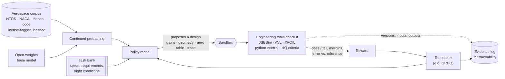

<div align="center">

# aero-foundation

**An aerospace engineering model that learns from the tools engineers trust.**

An open-weights language model, specialized for flight control, aerodynamics, and handling qualities through continued pretraining and reinforcement learning, where every reward comes from an engineering tool that computes a checkable answer.

[](LICENSE)
[](#status)
[](https://github.com/aerospace-superintelligence/aero-foundation/actions/workflows/pages.yml)
[](#certification-philosophy)
[](research/certification.md)

[Website](https://foundation.aerospace-superintelligence.com) · [Research](research/) · [Roadmap](#roadmap) · [Contributing](CONTRIBUTING.md)

</div>

---

## Mission

Aerospace engineering already has excellent ways to tell a right answer from a wrong one: flight simulators, vortex-lattice and panel codes, linear-systems toolboxes, and decades of handling-qualities criteria. General-purpose language models rarely use them, so they produce designs that read well and fail the first check.

aero-foundation aims to build a model whose engineering judgment is shaped by those checks. The target work is:

- **Flight control design**: propose gains and architectures that meet stability margins, bandwidth, and time-response requirements.
- **Aerodynamic databases**: set up and run analyses, then assemble coefficient tables and stability derivatives that agree with the tools.
- **Handling-qualities analysis**: compute modal characteristics and grade them against MIL-STD-1797A criteria.
- **Requirements traceability**: link requirements to design artifacts and verification cases in the style ARP4754B and DO-178C expect.

## Approach

Two training stages, both built on an open-weights base model.

1. **Continued pretraining** on a license-clean aerospace corpus: NASA and NACA reports, public-domain government documents, open theses, and open-source engineering code. Every document carries provenance (source, license, retrieval date, hash). See [`research/data-sources.md`](research/data-sources.md).
2. **Reinforcement learning with verifiable rewards.** The model proposes a design or answer, a sandboxed engineering tool checks it, and the check becomes the reward. No learned reward model sits between the physics and the gradient.



Held-out evaluation tasks, scored by the same tools, gate every checkpoint. Tool versions are pinned and hashed so any reward can be reproduced exactly.

## Verifiers & Tools

| Tool | Checks | Example reward |
| --- | --- | --- |
| [JSBSim](https://github.com/JSBSim-Team/jsbsim) | Nonlinear 6-DOF flight: trim, time responses, closed-loop behavior | Step response meets rise-time and overshoot specs |
| [AVL](https://web.mit.edu/drela/Public/web/avl/) | Vortex-lattice aero: lift, induced drag, moments, stability derivatives, neutral point | Proposed geometry trims at the target CL with static margin in band |
| [XFOIL](https://web.mit.edu/drela/Public/web/xfoil/) | 2-D airfoil analysis: polars, transition, pressure distribution | Airfoil meets a cl/cd target at the given Reynolds number |
| [OpenVSP](https://openvsp.org/) | Parametric geometry, VSPAERO analysis | Geometry is valid and matches area/span constraints |
| [python-control](https://python-control.readthedocs.io/) | Linear systems: poles, margins, bandwidth, step metrics | Loop meets gain and phase margins with the specified crossover |
| Handling-qualities criteria | MIL-STD-1797A / MIL-F-8785C modal criteria (short period, CAP, Dutch roll, roll mode, spiral, bandwidth) | Level 1 achieved in every required flight phase |

Full details, licenses, reward formulations, and sample tasks are in [`research/verifiers.md`](research/verifiers.md).

## Certification Philosophy

aero-foundation is a **ground-based engineering tool**. It is not airborne software and is not intended to run on an aircraft.

The long-term path is **tool qualification under DO-330**, in the context of programs following ARP4754B (system development assurance), DO-178C (airborne software), and DO-331 (model-based development). Our working architecture separates two kinds of component:

- **The model is a proposer.** Its outputs are treated as unverified until checked. We do not plan to claim certification credit for the model itself.
- **The checkers are deterministic, version-pinned tools.** These are the components that could be qualified, because their behavior can be specified, tested, and placed under configuration management.

Under this split, credit, if any is ever claimed, comes from independent verification of the outputs, not from trust in the model. Traceability is built in from day one: data provenance manifests, training configurations, weight hashes, verifier hashes, and per-task evidence logs.

Qualification is always granted within a specific certification project by the relevant authority. Nothing in this repository is qualified today. See [`research/certification.md`](research/certification.md). *This is engineering research, not regulatory advice.*

## Roadmap

| Phase | Goal | Exit criterion |
| --- | --- | --- |
| **0: Foundations** | Verifier harness, task bank, eval suite, data provenance pipeline, base-model baselines | Baseline scores for at least two open-weights models on the eval suite, reproducible from a single command |
| **1: RL with tool rewards** | RLVR on a small base model using the Phase 0 verifiers, no continued pretraining | Statistically significant improvement on held-out tool-graded tasks with no regression on general benchmarks |
| **2: Continued pretraining** | Aerospace corpus with license tagging, dedup, and decontamination | Domain perplexity and downstream gains without catastrophic forgetting |
| **3: CPT + RL at scale** | Combine stages, expand verifiers (JSBSim closed-loop, aero databases, traceability) | Beats the strongest prompted baseline on the full eval suite |
| **4: Qualification-oriented hardening** | TOR/TQP drafts for the verifier tools, evidence automation | Evidence package dry run against DO-330 objectives |

The phase plan, with compute estimates stated as assumptions, is in [`research/experiment-plan.md`](research/experiment-plan.md).

## Research

| Document | Contents |
| --- | --- |
| [`landscape.md`](research/landscape.md) | Survey: domain LLMs for science and engineering, LLMs driving engineering tools, RL with verifiable rewards, and LLM work in aerospace and controls |
| [`data-sources.md`](research/data-sources.md) | Candidate corpora with licenses, and what needs a paid license |
| [`verifiers.md`](research/verifiers.md) | Tools usable in the training loop: what each checks, reward design, license, sample task, and computable handling-qualities criteria |
| [`certification.md`](research/certification.md) | How a model-based ground tool could be qualified under DO-330, and the evidence that requires |
| [`experiment-plan.md`](research/experiment-plan.md) | Phased experiment plan with compute assumptions |

## Status

**Phase 0, founding.** This repository currently holds research and planning documents. There is no trained model, and no capability claims are made. Work is tracked in [issues](https://github.com/aerospace-superintelligence/aero-foundation/issues) under the [Phase 0 milestone](https://github.com/aerospace-superintelligence/aero-foundation/milestones).

## Contributing

Contributions are welcome on four tracks: **data**, **verifiers**, **eval**, and **certification**. Read [CONTRIBUTING.md](CONTRIBUTING.md) first. In short: show evidence, never add restricted or export-controlled material, and make rewards hard to game. Report security issues privately per [SECURITY.md](SECURITY.md).

## Citation

```bibtex
@software{aero_foundation_2026,
  title        = {aero-foundation: an aerospace engineering model trained with tool-verified rewards},
  author       = {{Aerospace Superintelligence contributors}},
  year         = {2026},
  url          = {https://github.com/aerospace-superintelligence/aero-foundation},
  license      = {Apache-2.0}
}
```

GitHub's "Cite this repository" button reads [`CITATION.cff`](CITATION.cff).

## License

[Apache-2.0](LICENSE). Third-party tools keep their own licenses; several verifiers are GPL or LGPL and are invoked as separate processes.

<sub>Part of [Aerospace Superintelligence](https://aerospace-superintelligence.com). Standards are cited by name for context only. aero-foundation is not affiliated with or endorsed by SAE, RTCA, EUROCAE, the FAA, EASA, or the US DoD.</sub>
