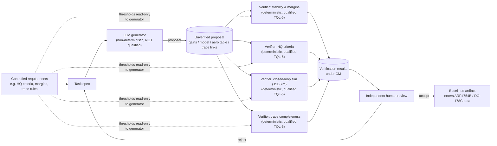
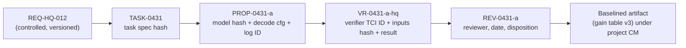

# Certification research: qualifying aero-foundation as a ground-based engineering tool

*Research snapshot as of 2026-10-15. Scope: how a model-based, LLM-driven **ground** engineering tool could earn certification credit under RTCA DO-330 / EUROCAE ED-215, and what traceability and evidence that would take.*

> [!IMPORTANT]
> **This is engineering research, not regulatory or legal advice.** Nothing here is a determination of compliance. The certification authority (FAA, EASA, or a military airworthiness authority) decides tool qualification credit, and it decides it **on a specific certification project, for a specific applicant, for a specific intended use**. A tool is never "qualified" in isolation. Several sources below are drafts, consultation documents, vendor material or conference slides; this document says which is which. Treat every claim as something to confirm with the applicant's certification team before relying on it.

> [!NOTE]
> **How claims are marked.** A claim with a link was confirmed against that source (fetched 2026-10-15). A claim marked *(general understanding)* reflects common industry practice that I could not confirm from a fetched public source; treat it as a hypothesis. RTCA and SAE documents are paywalled and were **not** read. Where this document describes their contents, it relies on public FAA/EASA material and secondary sources that describe them.

---

## Contents

- [Summary](#summary)
- [1. Background](#1-background)
- [2. The core architectural argument: generator vs. checkers](#2-the-core-architectural-argument-generator-vs-checkers)
- [3. What a DO-330 qualification package would contain](#3-what-a-do-330-qualification-package-would-contain)
- [4. Traceability and evidence specific to an ML-based tool](#4-traceability-and-evidence-specific-to-an-ml-based-tool)
- [5. AI assurance guidance and in-progress standards (status as of 2026-10-15)](#5-ai-assurance-guidance-and-in-progress-standards-status-as-of-2026-10-15)
- [6. A practical staged path](#6-a-practical-staged-path)
- [7. Open questions and risks](#7-open-questions-and-risks)
- [Sources](#sources)

---

## Summary

1. **Don't qualify the LLM. Qualify the checkers.** Treat every LLM output (control law structure, gains, aero database entries, trace links, analysis text) as an *unverified proposal*. Get credit only from independent, deterministic verifier tools and from human review. Qualify the verifiers under DO-330, typically at **TQL-5** (Criteria 3). If a verifier's result is also used to reduce *other* activities, it becomes Criteria 2, which is **TQL-4** at software levels A and B.
2. **Under that architecture, the LLM drops out of the qualification argument**, because tool qualification applies only when a tool's output is not otherwise verified. The LLM still needs strict configuration management (weights, data, decoding settings, logs). The purpose is reproducibility, problem reporting and disclosure to the authority, not qualification credit.
3. **Qualifying the LLM itself (Option B) has no mature path today.** EASA's *proposed* Concept Paper Issue 03 (June 2026, consultation closed 12 August 2026) brings AI-based development and verification tools and LLMs into scope. It caps "large off-the-shelf models" such as general-purpose LLMs at **AL5 / TQL5 / DAL D**. NPA 2025-07 and the first issue of ED-324/ARP6983 do not cover generative AI or reinforcement learning. Keep Option B as a research track only.

---

## 1. Background

### 1.1 When DO-178C requires tool qualification

DO-178C section 12.2 asks for tool qualification when a tool **eliminates, reduces or automates** a software life cycle process **and its output is not verified** by some other means ([AdaCore, DO-178C standards suite overview](https://learn-latest.adacore.com/booklets/adacore-technologies-for-airborne-software/chapters/standards.html); [AFuzion DO-330 introduction](https://afuzion.com/?p=358)). The FAA defines tool qualification as the process needed to get certification credit for a software tool *within the context of a specific airborne system* ([FAA Order 8110.49A, Chapter 1 definitions](https://www.faa.gov/documentLibrary/media/Order/FAA_Order_8110.49A.pdf)). That project-specific framing runs through everything below. Vendors sell tools that are "qualifiable", and only a project makes a tool "qualified" ([AdaCore overview](https://learn-latest.adacore.com/booklets/adacore-technologies-for-airborne-software/chapters/standards.html)).

### 1.2 Tool Criteria 1/2/3 and TQL-1..TQL-5

DO-178C section 12.2.2 and its Table 12-1 set five Tool Qualification Levels (TQLs) from two inputs: how the tool is used (its criterion) and the software level of the software it affects ([FAA AC 20-115D, para 8.c(1)](https://www.faa.gov/documentLibrary/media/Advisory_Circular/AC_20-115D.pdf)). The three criteria, paraphrased from a public presentation that summarizes DO-178C ([Cofer, Rockwell Collins, 2015](https://sos-vo.org/system/files/sos_files/Qualification_of_Formal_Methods_Tools.pdf)):

| Criterion | Tool role | Failure mode |
|---|---|---|
| **1** | Its output is part of the airborne software (it automates development) | It could **insert** an error |
| **2** | It automates verification, and its output is used to justify eliminating or reducing *other* verification, or development processes that could affect the airborne software | It could **fail to detect** an error, and other safeguards were reduced because of it |
| **3** | It automates verification, and no other activity is reduced | It could **fail to detect** an error |

The resulting TQLs (TQL-1 is the most rigorous, TQL-5 the least):

| Software level | Criterion 1 | Criterion 2 | Criterion 3 |
|---|---|---|---|
| A | TQL-1 | TQL-4 | TQL-5 |
| B | TQL-2 | TQL-4 | TQL-5 |
| C | TQL-3 | TQL-5 | TQL-5 |
| D | TQL-4 | TQL-5 | TQL-5 |

This mapping comes from [Cofer 2015](https://sos-vo.org/system/files/sos_files/Qualification_of_Formal_Methods_Tools.pdf). It matches the DO-178B-to-DO-178C correlation table (Table 2) in [AC 20-115D](https://www.faa.gov/documentLibrary/media/Advisory_Circular/AC_20-115D.pdf) and [AMC 20-115D](https://www.easa.europa.eu/en/document-library/easy-access-rules/online-publications/easy-access-rules-acceptable-means?page=22). In that table, former "development tools" correspond to Criterion 1 (TQL-1 to TQL-4 for levels A to D), and former "verification tools" to Criterion 2 (TQL-4 for A/B, TQL-5 for C/D) or Criterion 3 (TQL-5 at every level).

**Why this matters for aero-foundation.** The jump from Criterion 3 to Criterion 2 is where projects get caught out. A verifier that only checks the specific artifact it was built to check stays at TQL-5. If the project then argues "the checker passed, so we can skip some other review or test", the same checker becomes Criterion 2, which is TQL-4 at levels A and B. Cofer's slides make the same point ([Cofer 2015](https://sos-vo.org/system/files/sos_files/Qualification_of_Formal_Methods_Tools.pdf)).

### 1.3 DO-330 / ED-215 as a domain-independent tool standard

DO-330 (RTCA, December 13, 2011) and ED-215 (EUROCAE, January 2012) are the same document, *Software Tool Qualification Considerations* ([AC 20-115D, para 2](https://www.faa.gov/documentLibrary/media/Advisory_Circular/AC_20-115D.pdf)). Key points:

- **It is stand-alone, not a DO-178C supplement.** It was written to be domain-independent, so other domains (for example electronic hardware, aeronautical databases, automotive and space) can use it ([Tasking DO-330 overview](https://www.tasking.com/do-330/); [Pothon, *DO-330/ED-215 Benefits*, AdaCore](https://www.adacore.com/books/do-330-ed-215-benefits)). This is what lets it apply to a ground engineering tool whose outputs are aircraft design data rather than airborne code.
- **It has its own complete set of objectives, activities and life cycle data** ([AC 20-115D, para 10](https://www.faa.gov/documentLibrary/media/Advisory_Circular/AC_20-115D.pdf)). It uses a planning / development / verification life cycle with integral processes: configuration management, quality assurance and qualification liaison. Its Annex A tables list the objectives that apply at each TQL ([AFuzion](https://afuzion.com/?p=358)).
- **It separates two contexts** ([Cofer 2015](https://sos-vo.org/system/files/sos_files/Qualification_of_Formal_Methods_Tools.pdf); [Slotosch, *How-To Qualify Eclipse-Based Tools*, 2012](https://wiki.eclipse.org/images/c/cb/HowToQualifyEclipseBasedTools.pdf)):
  - The **tool user (operational) context**: Tool Operational Requirements (TOR), and verification and validation of the tool against them in the user's environment.
  - The **tool developer context**: tool requirements derived from the TOR, plus development and verification of the tool itself.
  - Per Cofer, **TQL-5 needs only the user-context activities**. TQL-1 to TQL-4 also need developer-context objectives that come close to those for the safety-critical software itself.
- **Errata.** ED-215/DO-330 has had at least one corrigendum or errata since 2011 *(general understanding; I could not load a catalog page to confirm it)*. Confirm the exact revision the project will cite.

### 1.4 Recognition by FAA and EASA

- **FAA AC 20-115D** (21 July 2017) recognizes DO-178C, DO-330 and the supplements DO-331/332/333 (with their ED equivalents) as an acceptable, non-mandatory means of compliance ([AC 20-115D](https://www.faa.gov/documentLibrary/media/Advisory_Circular/AC_20-115D.pdf)). Points relevant here:
  - Section 12.2 of DO-178C together with DO-330 is an acceptable method for tool qualification (para 10).
  - Applicants should submit the tool qualification data that DO-330 section 9.0.a calls for (para 6.b).
  - Tool changes, or changes to the tool's operational environment, need a tool change impact analysis under DO-330 sections 11.2.2 / 11.2.3 (para 8.c(2)).
  - If a qualified tool is built with supplement techniques (for example model-based development) at TQL-1 to TQL-4, the Tool Qualification Plan should say which tool qualification objectives those techniques affect (para 8.a(2)).
- **EASA AMC 20-115D** (ED Decision 2017/020/R) is the harmonized EASA equivalent. It recognizes ED-215/DO-330 and the supplements, and contains the same tool-type-to-TQL correlation table ([EASA Easy Access Rules, AMC 20-115D](https://www.easa.europa.eu/en/document-library/easy-access-rules/online-publications/easy-access-rules-acceptable-means?page=22)).
- **FAA Order 8110.49A** (*Software Approval Guidelines*, effective 29 March 2018) is FAA staff guidance for software reviews and conformity ([Order 8110.49A](https://www.faa.gov/documentLibrary/media/Order/FAA_Order_8110.49A.pdf)). Relevant content:
  - The project-specific definition of tool qualification quoted in 1.1.
  - Software reviews sample trace data from system requirements down to test results, and also sample SQA and configuration management records. That is the kind of evidence chain section 4 proposes.
  - During software conformity inspection, development or verification tools that require qualification should already be qualified. If qualification is not finished, their configuration should at least be documented.
  - The Order's table of contents (Chapters 1–4 plus appendices) contains **no** stand-alone tool qualification chapter. The older 8110.49 had one, but I did not confirm the earlier chapter's contents.

### 1.5 ARP4754B: system-level development assurance, and where this tool sits

[SAE ARP4754B](https://saemobilus.sae.org/content/ARP4754B) (20 December 2023; ED-79B at EUROCAE) gives guidelines for developing civil aircraft and systems:

- It covers validating requirements and verifying the design implementation, and refers software to DO-178C and safety assessment to ARP4761A.
- A secondary summary says Revision B mainly aligns with ARP4761A. It keeps the development assurance level (FDAL/IDAL) principles while moving procedural detail to ARP4761A, and gives more emphasis to unintended behaviour ([DMD Solutions, Jan 2024](https://dmd.solutions/blog/arp4754b-updates)).
- **FAA recognition.** FAA AC 20-174 recognizes **ARP4754A**, not B, and refers to FDAL/IDAL assignments ([AC 20-174](https://www.faa.gov/documentLibrary/media/Advisory_Circular/AC_20-174.pdf)). I could not confirm any FAA AC that recognizes ARP4754B. Whether B is accepted on a project is a question for that project.

**Where aero-foundation's target uses would sit** *(general understanding)*:

| Use | Life-cycle home | Typical artifact |
|---|---|---|
| Flight control law design (structure, gains, schedules) | ARP4754B system/item requirements and design. Becomes software life cycle data once captured as models or parameter data under DO-178C/DO-331 | Control law requirements, design models, gain tables |
| Aero database generation | System-level design data. Feeds control design, simulators and possibly airborne tables | Coefficient tables with their validity domain |
| Handling-qualities analysis | Validation of system requirements and verification of the design (analysis and simulation before flight test) | Analysis reports against chosen criteria, e.g. MIL-STD-1797A for military programmes |
| Requirements traceability | ARP4754B traceability and DO-178C trace objectives | Trace matrices and trace-gap reports |

For **system-level** (ARP4754B) uses, how tools are assessed is set by the ARP4754B text and by agreement with the authority. I could not read the ARP4754B text, so I can't say what it requires for tools. Applicants commonly borrow DO-330 concepts by analogy *(general understanding)*. For **software life cycle** uses (code, models, parameter data, software verification), DO-178C 12.2 and DO-330 apply directly.

[MIL-STD-1797A](https://quicksearch.dla.mil/qsDocDetails.aspx?ident_number=70037) (*Flying Qualities of Piloted Aircraft*, base issue 30 January 1990, with later notices) is a DoD interface standard. ASSIST lists Revision A and its 1995 Change Notice 1 as Distribution D (DoD and contractors only), so the project uses the publicly released MIL-F-8785C for verifier limits (see [verifiers.md](verifiers.md)). It does not belong to the FAA/EASA framework. Its criteria are useful as **machine-checkable requirements** for a handling-qualities verifier, but the project must pick the specific criteria and boundary values for each programme. Military airworthiness authorities have their own processes for accepting tools. This document does not cover those processes, and I did not confirm how they treat DO-330 *(general understanding)*.

### 1.6 DO-331: models as requirements/design, and simulation as verification credit

DO-331 (ED-218) is the model-based development and verification supplement. It is used together with DO-178C, never alone ([AC 20-115D, para 8.a](https://www.faa.gov/documentLibrary/media/Advisory_Circular/AC_20-115D.pdf); [RTCA DO-178 family page](https://www.rtca.org/do-178/)). Key points:

- **Model roles.** Specification models stand in for high-level requirements. Design models stand in for low-level requirements and architecture ([Tasking DO-331 overview](https://www.tasking.com/do-331/)).
- **Simulation credit is limited.**
  - Simulation can supply evidence that a model meets its requirements.
  - It does **not** remove the need to test the executable object code on target hardware ([Rapita DO-331](https://rapitasystems.com/do-331); [Tasking](https://www.tasking.com/do-331/)).
  - Model coverage analysis can find unintended functionality, but it does not replace structural coverage of the code ([Tasking](https://www.tasking.com/do-331/)).
- **FAA clarification of DO-331 MB.6.8.1.** If simulation is used in place of reviews and analyses, the applicant should name each objective it is meant to satisfy and justify in detail how simulation fully satisfies it. Every other objective still needs reviews and analyses ([AC 20-115D, para 8.a(3)](https://www.faa.gov/documentLibrary/media/Advisory_Circular/AC_20-115D.pdf)).
- **Tools in the DO-331 workflow.** Where a modelling, simulation or code-generation tool needs qualification, DO-330 is the process ([Tasking](https://www.tasking.com/do-331/)).

**Where LLM-produced models and gains land.** If aero-foundation proposes a control law as a design model, or a set of gains and schedules that end up in a design model or parameter table, that content becomes **software life cycle data at the specification or design model level**. A tool that produced it would be a Criterion 1 tool (TQL-1 for level A) *unless its output is fully verified*. That alone is a strong reason to keep the LLM out of the qualification argument (section 2):

- Under DO-331, the model must still be reviewed and analyzed, or verified by justified simulation, against its requirements.
- The JSBSim/python-control-based verifiers that produce that simulation evidence are the tools whose qualification matters.
- Any simulation credit needs the per-objective justification described above.

---

## 2. The core architectural argument: generator vs. checkers

The verifier names are hypothetical. The point is the split: credit flows only through the right-hand side, the deterministic checks and the human review.

### 2.1 Option A: don't qualify the LLM

**How it works.**

- Every LLM output is an *unverified proposal*.
- Credit comes only from (a) independent, deterministic verifier tools, qualified where their results replace a verification activity, and (b) review by competent engineers.
- The LLM is a design aid, much like an engineer's scratchpad. DO-178C 12.2 asks for qualification only when a tool's output is *not verified*. If every output is fully verified, the generator needs no qualification ([AdaCore overview](https://learn-latest.adacore.com/booklets/adacore-technologies-for-airborne-software/chapters/standards.html)).

**Evidence that this is the expected route.**

- **EASA (September 2026).** EASA told the ICAO Asia-Pacific DGCA conference that a risk-based filter should decide whether an AI-based tool needs qualification. Tools whose outputs are fully and independently verified may not need it. Tools whose outputs are relied on without such verification should be qualified in proportion to the risk ([EASA, DGCA-61/DP/03/06, para 1.3](https://www.icao.int/sites/default/files/APAC/Meetings/2026/2026%20DGCA61/Agenda%20Item03-Aviation%20Safety/61-DP-03-06_EASA_EASA-APPROACH-TO-ARTIFICIAL-INTELLIGENCE-IN-AVIATION.pdf)). EASA's proposed Concept Paper Issue 03 says this filtering will be deployed in step 2 of RMT.0742 ([EASA CP Proposed Issue 03](https://www.easa.europa.eu/en/downloads/143701/en)).
- **Formal-methods precedent.** The formal-methods community has long argued for qualifying a small checker (TQL-5) rather than a complex generator (TQL-1). One example is qualifying a code verifier instead of a code generator ([Cofer 2015](https://sos-vo.org/system/files/sos_files/Qualification_of_Formal_Methods_Tools.pdf)).
- **FAA principle.** The FAA roadmap says to treat AI as a tool, not a human, and keeps responsibility with the designer ([FAA AI Safety Assurance Roadmap, Version I](https://www.faa.gov/media/82891)).

**What it buys.**

- No need to argue the internal correctness of a multi-billion-parameter model.
- Model updates (new weights, new RL run) do **not** invalidate the qualification of the verifiers, provided verifier TORs, inputs and environment are unchanged. A tool change impact analysis is still prudent for anything that touches the verification path ([AC 20-115D, para 8.c(2)](https://www.faa.gov/documentLibrary/media/Advisory_Circular/AC_20-115D.pdf)).
- The qualified verifiers are small, deterministic, open-source Python/C++ components with ordinary software verification. Achieving TQL-5 is realistic for them.
- The same verifiers are the RL reward sources, so training and certification share one source of truth for "correct". That also creates a risk (see 7.2).

**What it costs.**

- **Credit is bounded by verifier coverage.** The tool earns credit only for what the verifiers and reviewers actually check. Properties that no verifier covers (for example the physical plausibility of an aero coefficient outside the AVL/XFOIL validity domain) need human review or other verification.
- **Throughput depends on human review.** The productivity gain comes from generating good proposals quickly, not from skipping verification.
- **The verifiers' physics is only as good as their inputs.** A qualified JSBSim run on an unvalidated aircraft model proves nothing about the aircraft. Validating input data is separate from tool qualification *(general understanding)*.
- **Criterion creep.** Once anyone argues that "the verifier passed, so step X can be reduced", the verifier becomes Criterion 2 (TQL-4 at levels A/B), which needs developer-context objectives.

### 2.2 Option B: qualify the LLM-based tool itself

**How it works.** The LLM-based generator (or the whole agentic tool) would be qualified under DO-330, so that its outputs could be trusted *without* full independent verification. For design outputs that end up in software, that is Criterion 1 (TQL-1 to TQL-4).

**Obstacles.**

1. **Non-determinism.**
   - Sampling is stochastic. Even greedy decoding can vary across GPU kernels, batch sizes, parallelism and library versions *(general understanding)*.
   - DO-330 verification assumes a tool behaves the same way when its inputs and environment are fixed.
   - EASA's proposed Issue 03 notes that GPU and cloud computing will need specific guidance, and asks for an analysis of how repeatable the learning process is (Objective SU-LM-05) ([EASA CP Proposed Issue 03](https://www.easa.europa.eu/en/downloads/143701/en)).
2. **No traceable requirements-to-behaviour mapping.** DO-330's developer context derives tool requirements from the TOR, then design and code from those. Learned weights don't trace to requirements:
   - The ED-324/ARP6983 statement of concerns names exactly this gap ([G-34/WG-114, FAA TEM, Aug 2025](https://na.eventscloud.com/file_uploads/115fca49330a77ce92d7fe04e9874faf_Day1-Jahn-202508ED-324ARP6983presFAAAI-MLTechExchangeMeeting_8-5-25-Read-Only.pdf)).
   - The FAA roadmap observes that, for learned AI, the designer cannot derive the lower-level requirements in the usual way ([FAA roadmap](https://www.faa.gov/media/82891)).
   - EASA says LLMs can show emergent behaviour, including "hallucination" ([EASA CP Proposed Issue 03](https://www.easa.europa.eu/en/downloads/143701/en)).
3. **Structural coverage is meaningless for weights.** Covering the inference-engine code says nothing about the learned function *(general understanding)*. ML-specific substitutes (data coverage, operational-domain coverage, robustness and stability metrics) are what EASA and ED-324 develop, and they target supervised models of manageable size.
4. **Configuration management at scale.** Training data, continued-pretraining corpora, RL environments, reward code, hyperparameters and weights all become configuration items. EASA's draft Objective SURK-CM-01 and MOC SU-CM-01 would require identification, versioning, baselining, change control, reproducibility, problem reporting and archiving. Datasets and data-processing tooling would also be configuration items ([EASA CP Proposed Issue 03](https://www.easa.europa.eu/en/downloads/143701/en)). This is feasible but heavy, and step 1 is hard for a base model trained by a third party on data the project cannot fully see.
5. **Explicit ceilings in current drafts.**
   - **EASA proposed Issue 03 caps "large OTS models".** It names general-purpose LLMs as the example, since their parameter count and training data make the design process intractable to control. The cap is **IDAL D / AL5 / TQL5**, and the paper says such models should not contribute to hazardous or catastrophic failure conditions ([EASA CP Proposed Issue 03, Applicability and Section 3.7.2.1](https://www.easa.europa.eu/en/downloads/143701/en)).
   - **aero-foundation would very likely fall in that category.** It continues pretraining from an open-weights base model, and the paper's reuse section counts open-source models as off-the-shelf.
   - **RL is capped too.** RL is in scope of Issue 03 only up to IDAL C / TQL3. Training environments that provide verification credit would need to be qualified to match that credit (Objectives SU-LM-03 / R-LM-03).
   - **The adopted framework doesn't cover generative AI.** NPA 2025-07 covers supervised and unsupervised ML only, deferring RL and generative AI ([EASA NPA 2025-07 announcement](https://www.easa.europa.eu/newsroom-and-events/news/easas-first-regulatory-proposal-artificial-intelligence-aviation-now-open)). ED-324/ARP6983 Issue 1 covers non-adaptive supervised ML up to IDAL C ([G-34/WG-114, Aug 2025](https://na.eventscloud.com/file_uploads/115fca49330a77ce92d7fe04e9874faf_Day1-Jahn-202508ED-324ARP6983presFAAAI-MLTechExchangeMeeting_8-5-25-Read-Only.pdf)).

**What it would buy.** Credit for LLM outputs beyond what deterministic verifiers can check, for example judgement-heavy review activities. Even under the most generous current draft, that would only be at TQL-5-equivalent rigour, which is the same level Option A gets for the deterministic verifiers.

**What it costs.** An open-ended research programme, with no authority-endorsed means of compliance for generative models today. Every model update would need requalification.

### 2.3 Assessment

| | Option A: qualify verifiers only | Option B: qualify the LLM tool |
|---|---|---|
| Credit available | Whatever the qualified verifiers plus human review cover | In principle more; in practice capped (TQL5-equivalent for large OTS models in EASA's *proposed* guidance) |
| Standards basis today | DO-178C 12.2 + DO-330 (recognized by AC/AMC 20-115D) | Drafts only (EASA CP Issue 03 proposed; ED-324 Issue 1 doesn't cover LLMs or RL) |
| Effect of a model update | LLM CM record and non-regression evals; verifier qualification unchanged | Requalification |
| Main risk | Verifier blind spots; automation bias in review | Regulatory dead end; requalification cost on every update |
| Recommendation | **Primary path** | **Research track only**; collect evidence, claim nothing |

**Unresolved even for Option A** (also see section 7):

- Whether an authority will accept "fully verified" for design outputs that are partly judgement-based (for example control law *structure*, not just gains).
- How much human review is enough when the reviewer has seen the LLM's proposal and may be anchored by it.
- Whether the RL reward verifiers and the certification verifiers can be the same binaries without weakening independence.

---

## 3. What a DO-330 qualification package would contain

DO-330 data items, as named in public descriptions of the standard:

| Data item | Source of the name |
|---|---|
| Tool Qualification Plan (TQP) | [Slotosch 2012](https://wiki.eclipse.org/images/c/cb/HowToQualifyEclipseBasedTools.pdf); [Tasking](https://www.tasking.com/do-330/) |
| Tool Operational Requirements (TOR) | [Cofer 2015](https://sos-vo.org/system/files/sos_files/Qualification_of_Formal_Methods_Tools.pdf); [Slotosch 2012](https://wiki.eclipse.org/images/c/cb/HowToQualifyEclipseBasedTools.pdf) |
| Tool Requirements (TR) | [Slotosch 2012](https://wiki.eclipse.org/images/c/cb/HowToQualifyEclipseBasedTools.pdf) |
| Tool Configuration Index (TCI) | [Slotosch 2012](https://wiki.eclipse.org/images/c/cb/HowToQualifyEclipseBasedTools.pdf) |
| Tool Accomplishment Summary (TAS) | [Slotosch 2012](https://wiki.eclipse.org/images/c/cb/HowToQualifyEclipseBasedTools.pdf); [Tasking](https://www.tasking.com/do-330/) |
| Tool quality assurance (TQA) and tool configuration management (TCM) records | [Slotosch 2012](https://wiki.eclipse.org/images/c/cb/HowToQualifyEclipseBasedTools.pdf) |

The exact contents of each item, and which items must be submitted versus kept available, are defined in DO-330 itself (which I did not read). AC 20-115D points to DO-330 section 9.0.a for submittals. Below I describe the items in general terms.

### 3.1 Per-verifier package (target: TQL-5, user/operational context)

At TQL-5 the operational (user-context) activities are the core: define the TOR, then verify and validate the tool against the TOR in its operational environment ([Cofer 2015](https://sos-vo.org/system/files/sos_files/Qualification_of_Formal_Methods_Tools.pdf)). The Annex A tables say which objectives apply at each TQL ([AFuzion](https://afuzion.com/?p=358)). Confirm the exact subset against DO-330 Annex A with the applicant.

Hypothetical verifier set: `margins-check` (python-control loop-break margins), `hq-check` (handling-qualities criteria on linear models), `sim-check` (JSBSim scenario runner with pass/fail thresholds), `aerodb-check` (consistency of aero tables against AVL/XFOIL reference runs within declared validity domains), `trace-check` (trace completeness and consistency).

| Data item | What it would contain for an aero-foundation verifier |
|---|---|
| **TQP** | <ul><li>Which verifier, which certification-credit claim (which DO-178C/DO-331 objective or ARP4754B validation/verification activity it supports)</li><li>Criterion and TQL determination, with the rationale for "Criterion 3, not 2"</li><li>Operational environment</li><li>Roles (tool developer = aero-foundation project; tool user = applicant)</li><li>Life cycle, CM, QA and liaison plans</li><li>Known limitations</li></ul>A tool-specific plan adapted by the tool user to the project ([Slotosch](https://wiki.eclipse.org/images/c/cb/HowToQualifyEclipseBasedTools.pdf)). Referenced from the applicant's PSAC or system certification plan. |
| **TOR** | <ul><li>What the tool does from the user's perspective: inputs (linear model, criteria set, thresholds), outputs (pass/fail per criterion with computed values), operating modes</li><li>Validity domain: Mach/Re/AoA ranges for aero checks, model order limits, numerical tolerances</li><li>Error detection: what the tool reports when inputs fall outside the domain</li><li>For `hq-check`: which MIL-STD-1797A (or other) criteria, with the boundaries chosen for the programme</li></ul> |
| **Tool verification cases, procedures and results (operational)** | <ul><li>Test cases that trace to each TOR, run in the user's installed environment ([Cofer](https://sos-vo.org/system/files/sos_files/Qualification_of_Formal_Methods_Tools.pdf); [Slotosch](https://wiki.eclipse.org/images/c/cb/HowToQualifyEclipseBasedTools.pdf))</li><li>Reference oracles: analytic solutions (for example known second-order systems for margins), published benchmark cases, and independent re-computation</li><li>Must include negative tests: cases where the tool must fail, or must reject an out-of-domain input</li></ul> |
| **TOR validation** | Evidence that the TOR are right for the intended use, i.e. that a pass/fail from this tool really answers the review or analysis question being replaced. |
| **TCI** | <ul><li>Exact identification of the qualified tool: source commit, build recipe, container digest</li><li>Pinned third-party dependencies (JSBSim, AVL, XFOIL, python-control, NumPy/SciPy, BLAS), with versions and hashes</li><li>Platform, and configuration files</li></ul> |
| **Tool CM records** | Baselines, change requests, problem reports, archive and retrieval. |
| **Tool QA records** | <ul><li>Evidence that the plans were followed: audits and transition-criteria checks</li><li>Conformity of the delivered tool to the TCI</li></ul> |
| **TAS** | Summary of the qualification activities, deviations from the TQP, open problem reports and their impact, the qualified configuration (by reference to the TCI), and a statement of compliance for the applicant to use. |

**Open-source dependencies.** JSBSim, AVL and XFOIL would be third-party components *inside* qualified verifiers. Slotosch describes splitting tool objectives between tool user and tool developer for COTS components ([Slotosch 2012](https://wiki.eclipse.org/images/c/cb/HowToQualifyEclipseBasedTools.pdf)). At TQL-5 the practical approach is to put the whole verifier, including the third-party solver, under one TOR and one operational test suite, and to record known solver limitations as TOR assumptions *(general understanding)*. XFOIL's known accuracy limits near stall, for example, belong in that TOR as an explicit validity domain.

**If a verifier is Criterion 2 (TQL-4 at level A/B).** The package grows to developer-context items: tool requirements derived from the TOR, tool design, tool source code reviews, requirements-based testing of the tool, and the corresponding verification and trace data ([Cofer 2015](https://sos-vo.org/system/files/sos_files/Qualification_of_Formal_Methods_Tools.pdf); [Slotosch 2012](https://wiki.eclipse.org/images/c/cb/HowToQualifyEclipseBasedTools.pdf)). Avoid this by design: don't use verifier passes to reduce *other* activities.

### 3.2 Package for the overall aero-foundation tool (orchestrator + LLM)

Under Option A, the overall tool is **not qualified**. Its package documents *why*: a **tool assessment** showing that no credit is claimed for its outputs, because every output goes through qualified verifiers and human review before it enters the life cycle data. Contents:

- **The assessment itself.** For each intended use, an analysis of whether the tool eliminates, reduces or automates a process without its output being verified. The expected answer is "no" for the generator, provided the pipeline enforces verification.
- **Integrity of the verification path.**
  - The orchestrator cannot alter requirements, thresholds, verifier configuration or results.
  - It cannot mark a proposal "verified" without a verifier result and a human sign-off.
  - Enforce this technically (separate processes, read-only mounts, signed result records) and test it. This is the one part of the orchestrator that could need qualification itself, as part of the verification chain *(general understanding)*.
- **Configuration records for the generator.** Section 4: not for credit, but for reproducibility, problem reporting and authority disclosure.
- **A user guide that states the limitation.** Outputs are proposals; no credit without the verification pipeline.

---

## 4. Traceability and evidence specific to an ML-based tool

These records serve three purposes:

1. They make verifier results **attributable**: which proposal, from which model, checked by which verifier build.
2. They support **problem reporting and impact analysis** when a model or verifier changes.
3. They meet the FAA's planned expectation that applicants disclose AI use in system development or in producing certification documents. That expectation appears in the roadmap as a planned 4Q2024 draft policy statement, and I could not confirm it was issued ([FAA roadmap](https://www.faa.gov/media/82891)).

They also line up with EASA's draft AI configuration-management objectives ([EASA CP Proposed Issue 03](https://www.easa.europa.eu/en/downloads/143701/en)).

### 4.1 Evidence items

| Evidence item | Content | Maps to |
|---|---|---|
| **Dataset provenance manifest** | <ul><li>Per shard: source URL/identifier, licence, retrieval date, SHA-256, filtering/dedup pipeline version, inclusion rationale</li><li>Export-control and ITAR screen result</li><li>Contamination screen against eval sets</li></ul> | EASA draft SU-CM-01 (datasets and data tooling as CIs); generator CM record. For verifiers: TCI only if data is part of the verifier (for example reference polars) |
| **Training-run configuration** | Base model ID and weight hashes; continued-pretraining / SFT / RL configs; hyperparameters; seeds; framework, CUDA and driver versions; hardware; container digest; run logs | EASA draft SURK-CM-01 (reproducibility), SU-LM-05 (repeatability analysis) |
| **Model weight hashes** | SHA-256 per shard plus a manifest hash; quantization variant hashes, each a separate configuration item | Generator configuration index; problem reports |
| **Verifier version hashes** | Source commit, build recipe, container digest, dependency lock file | **TCI** of each qualified verifier |
| **Reward function versioning** | Reward code commit; verifier versions used *as rewards*; threshold sets; shaping terms; RL environment configs (JSBSim aircraft files, scenarios) | Generator CM. If RL environments are ever cited for verification credit, EASA draft R-LM-03 would need them qualified |
| **Eval results tied to a configuration** | Each eval run records model hash + decoding config + eval-suite version + verifier versions → metrics; stored immutably | Generator non-regression (EASA draft RU-04 asks that each OTS model update trigger a defined non-regression test set) |
| **Pinned decoding settings** | Temperature, top-p/top-k, max tokens, seed, stop sequences, system prompt hash, tool schema version, inference engine and version, batch settings | Generator CM. Note: pinned settings improve repeatability but do not guarantee bit-identical output on GPUs *(general understanding)* |
| **Prompt/response logging** | Full request/response, including tool calls, with timestamps, model hash and decoding-config hash; append-only, retained for the project's retention period | Problem reporting; authority disclosure; review records |
| **Requirement → task → proposal → verifier → result → review trace** | See 4.2 | ARP4754B traceability; DO-178C trace objectives; the trace sampling described in [Order 8110.49A](https://www.faa.gov/documentLibrary/media/Order/FAA_Order_8110.49A.pdf) |

### 4.2 The trace chain

Each record is immutable and content-addressed, and cites the hash of its predecessor. The key rule: **the artifact's credit chain runs REQ → VR → REV → ART**, and PROP shows only where the content came from. Remove PROP and the credit argument still holds. That is the operational test that Option A is really in force.

### 4.3 Mapping to DO-330 configuration management and the TCI

- **Qualified verifiers.** Their TCIs identify exactly what was qualified. Any change to a verifier, its dependencies or its operational environment triggers a tool change impact analysis ([AC 20-115D, para 8.c(2)](https://www.faa.gov/documentLibrary/media/Advisory_Circular/AC_20-115D.pdf)).
- **The generator.** It gets a separate *generator configuration index* covering items 1–7 of the table in 4.1. It is outside any TCI, because the generator isn't qualified. It sits under the same CM discipline: identification, baselines, change control, problem reports and archive. That matches EASA's draft SURK-CM-01 list.
- **The verification-path integrity components.** Result signing, orchestrator gating and review sign-off belong in the TCI for whatever verification chain claims credit.
- **Project-level indexes.** The applicant's software or system configuration indexes then reference specific verifier TCI versions and specific trace records.

---

## 5. AI assurance guidance and in-progress standards (status as of 2026-10-15)

| Item | Status confirmed | Relevance to a ground tool |
|---|---|---|
| **EASA AI Roadmap 2.0** | Published 10 May 2023; EASA calls it a living document, updated yearly ([EASA AI Roadmap page](https://www.easa.europa.eu/en/node/112143); [announcement](https://www.easa.europa.eu/en/newsroom-and-events/news/easa-artificial-intelligence-roadmap-20-published)). Defines Levels 0–3 of AI by the relationship between the AI and the human end user ([EASA DGCA-61 paper](https://www.icao.int/sites/default/files/APAC/Meetings/2026/2026%20DGCA61/Agenda%20Item03-Aviation%20Safety/61-DP-03-06_EASA_EASA-APPROACH-TO-ARTIFICIAL-INTELLIGENCE-IN-AVIATION.pdf)) | aero-foundation as an engineering assistant is best described as Level 1 (assistance) |
| **EASA AI Concept Paper Issue 2** | Published March 2024: guidance for Level 1 and 2 ML applications (learning assurance, explainability, ethics-based assessment, human-AI teaming) ([EASA](https://www.easa.europa.eu/en/document-library/general-publications/easa-artificial-intelligence-concept-paper-issue-2)) | Learning-assurance concepts; mainly airborne/ATM |
| **EASA AI Concept Paper Proposed Issue 03** | Published 3 June 2026 for a 10-week consultation (comments due 12 Aug 2026) ([EASA news](https://www.easa.europa.eu/en/newsroom-and-events/news/easa-releases-latest-issue-its-concept-paper-artificial-intelligence); [consultation page](https://www.easa.europa.eu/en/node/143699); [PDF](https://www.easa.europa.eu/en/downloads/143701/en)). See details below the table. **A proposal, not final** | **The most directly relevant document.** Ground tools used to develop approved products are explicitly in scope, and it sets the TQL ceilings in 2.2 |
| **EASA NPA 2025-07** (RMT.0742 step 1) | Published 10 Nov 2025, 3-month consultation. Detailed specifications on AI trustworthiness aligned to the EU AI Act. Covers supervised and unsupervised ML; RL, knowledge-based, hybrid and generative AI deferred. A second NPA was planned for 2026 ([EASA](https://www.easa.europa.eu/newsroom-and-events/news/easas-first-regulatory-proposal-artificial-intelligence-aviation-now-open)). I could not confirm whether the second NPA has been published | Doesn't yet cover LLMs or RL, so it offers no Option B path |
| **EASA position to ICAO APAC DGCA-61** | 7–11 Sep 2026 paper ([EASA DGCA-61/DP/03/06](https://www.icao.int/sites/default/files/APAC/Meetings/2026/2026%20DGCA61/Agenda%20Item03-Aviation%20Safety/61-DP-03-06_EASA_EASA-APPROACH-TO-ARTIFICIAL-INTELLIGENCE-IN-AVIATION.pdf)) | States the "independently verified outputs may not need qualification" filter that Option A relies on |
| **FAA Roadmap for AI Safety Assurance, Version I** | Signed 23 July 2024 ([FAA](https://www.faa.gov/media/82891)). See details below the table | Supports Option A's framing; flags LLM-assisted engineering as a research priority, not an accepted means |
| **FAA research: DOT/FAA/TC-26/2** | *Safety Assurance for AI/ML in Safety Critical Airborne Systems*, June 2026, Boeing with the FAA Technical Center ([TRID record](https://trid.trb.org/View/2724675)). A research report, not policy | Airborne focus |
| **SAE G-34 / EUROCAE WG-114** | See details below the table | Learning-assurance and data-management practice transfers; scope does not cover an LLM/RL tool |

**EASA Proposed Issue 03, details** ([PDF](https://www.easa.europa.eu/en/downloads/143701/en)):

- Adds reinforcement learning, symbolic AI and Level 3 automation.
- Treats LLMs as hybrid AI.
- Its scope includes AI-based systems used as **operational tools by approved organisations, including AI-based development and verification tools**.
- Caps large off-the-shelf models (for example general-purpose LLMs) at AL5 / TQL5 / IDAL D.
- Points to ED-215/DO-330 for tools where no software assurance guidance exists, with objectives scaled by TQL.

**FAA roadmap, details** ([FAA](https://www.faa.gov/media/82891)):

- Separates *learned* AI (fixed after training) from *learning* AI.
- Takes an incremental, project-specific approach using issue papers.
- Lists DO-330 and DO-331 among the existing standards that may be applied or extended.
- Ranks AI for software development, testing and requirements traceability as a high research priority, while noting LLMs can produce spurious or hallucinated material.
- Planned milestones: a policy statement (4Q2024 draft) on disclosing AI use, including in producing certification documents; a policy memo (4Q2024 draft); and certification position papers (1Q2026). **I could not confirm that any of these have been published.**

**SAE G-34 / EUROCAE WG-114, details:**

- Published: AIR6988/ER-022 (statement of concerns, 30 Apr 2021) and AIR6987/ER-027 (taxonomy, 12 Dec 2024) ([G-34/WG-114, Aug 2025](https://na.eventscloud.com/file_uploads/115fca49330a77ce92d7fe04e9874faf_Day1-Jahn-202508ED-324ARP6983presFAAAI-MLTechExchangeMeeting_8-5-25-Read-Only.pdf)).
- **ED-324 / ARP6983** status:
  - EUROCAE open consultation ran from 1 Aug 2025 ([EUROCAE](https://www.eurocae.net/open-consultation-for-ed-324/)).
  - An Aug 2025 target of June 2026 publication slipped. At EASA AI Days (9–10 Sep 2026) the group reported consensus reached on 24 Aug 2026, with EUROCAE Council approval and publication still to come, targeting Q4 2026 ([EASA AI Days 2026 deck](https://www.easa.europa.eu/en/downloads/144162/en)).
  - Issue 1 scope: non-adaptive supervised ML up to IDAL C / AL3 / SWAL2.
  - EASA is considering it as an anticipated AMC.
  - **Publication not confirmed as of 2026-10-15.** The title also varies across sources: "Development and Assurance guidelines / Considerations ..." in the decks, "Process Standard for Development and Certification Approval of Aeronautical Products Implementing AI" on the EUROCAE consultation page.
  - WG-114's video series includes a "Tool Qualification" episode. I did not review its content.

### 5.1 What transfers from airborne-ML guidance to a ground tool

Most of this material targets **airborne or ATM ML constituents**: a frozen model that flies or runs in operations. aero-foundation is different in kind. It is a ground tool whose outputs become design data. What transfers:

- **Directly applicable.**
  - EASA Proposed Issue 03's tool provisions: development and verification tools in scope, a risk-based qualification filter, and the large-OTS TQL5 ceiling.
  - DO-330 via AC/AMC 20-115D.
  - The FAA principle of designer accountability and "treat AI as a tool".
- **Transfers as good practice for the generator's CM** (no credit claimed):
  - Dataset management and provenance.
  - Repeatability analysis.
  - Configuration management of data and tooling.
  - Non-regression testing on every model update.
  - Operational-domain thinking, which maps to the TOR validity domains of the verifiers.
- **Mostly does not transfer.**
  - Run-time assurance, operational monitoring of a deployed model, and in-service data drift. These belong to airborne constituents.
  - Human-AI teaming in the cockpit. The engineer-reviewer relationship does share the automation-bias concern.
  - ED-324's ML constituent (MLC) construct, which bounds an airborne or ATM item.
- **Signals for Option B.** RL appears only in EASA's draft Issue 03, capped at IDAL C / TQL3. Generative AI appears only there, capped at TQL5 for large OTS models. Neither NPA 2025-07 nor ED-324 Issue 1 covers them.

---

## 6. A practical staged path

Tool qualification is always granted **inside a specific certification project, for a specific applicant and intended use** ([Order 8110.49A](https://www.faa.gov/documentLibrary/media/Order/FAA_Order_8110.49A.pdf); [AdaCore](https://learn-latest.adacore.com/booklets/adacore-technologies-for-airborne-software/chapters/standards.html)). aero-foundation as an open-source project can at most make its verifiers **qualifiable**, by shipping qualification kits. Only an applicant, working with its authority, can make them **qualified**.

| Stage | Credit claimed | What is qualified | Evidence produced | Exit criteria |
|---|---|---|---|---|
| **0: Research tool** | None. Outputs are research aids, re-done or fully re-verified by conventional means | Nothing | Generator CM records (section 4) built from day one; verifier test suites; public evals | Verifiers stable; trace chain implemented; generator CM complete enough to reproduce a past run |
| **1: Advisory with independent verification** | None for the LLM. Verifiers produce **qualifiable** evidence. Applicants may use them under their own processes (still no tool credit unless they qualify them) | Verifiers developed *to* DO-330 TQL-5 expectations: TQP/TOR/test suites/TCI/TAS templates as a "qualification kit" | Per-verifier TOR + operational test suites + TCI; verification-path integrity tests; TQP/TAS templates | At least one applicant willing to pilot; verifier TORs reviewed by an experienced DER/CVE or certification specialist |
| **2: Project-specific qualification with an applicant** | The applicant claims credit for specific objectives (for example a handling-qualities analysis or a trace-completeness check) via **TQL-5 verifiers**. The LLM stays unqualified | Named verifier versions, qualified **in that project**; the tool assessment showing the generator needs no qualification is accepted by the authority | Applicant's PSAC/certification plan referencing the TQP; project TQP/TAS; issue paper or CRI if the authority treats AI involvement as novel (the FAA roadmap expects project-specific issue papers) | Authority acceptance on that project; lessons learned recorded |
| **3: Broader acceptance** | Repeat use across projects becomes routine. Possibly a Criterion 2 verifier (TQL-4) where justified. Possibly a narrowly scoped generator qualification if mature guidance appears | Same as Stage 2, per project, with reusable kits; anything more is subject to future guidance (EASA RMT.0742 step 2, ED-324 issues and FAA position papers or ACs) | Accumulated project evidence; contributions to standards bodies | External: depends on published guidance, not on this project |

---

## 7. Open questions and risks

### 7.1 Regulatory and standards

1. **Is a design proposal "fully verified"?** Gains and table values can be checked against numeric criteria. Control-law *architecture* choices, modelling assumptions and analysis narratives involve engineering judgement. How much of that does human review have to cover before the authority accepts that the generator's output is "verified"?
2. **Status of EASA Proposed Issue 03.** The consultation closed 12 Aug 2026. The final text, including the large-OTS TQL5 ceiling and the tool filter, may change.
3. **FAA posture is unconfirmed.** I could not confirm that the planned FAA policy statement, policy memo or certification position papers on AI have been published. FAA–EASA harmonization on AI-based tools is unknown.
4. **ARP4754B acceptance and system-level tool assurance.** AC 20-174 recognizes ARP4754A. System-level tool expectations are not addressed in any public source I could read.
5. **Military programmes.** MIL-STD-1797A-based work sits under military airworthiness processes, whose stance on DO-330 and on AI tools is not covered here.
6. **ED-324/ARP6983 publication and scope.** Not confirmed published. Issue 1 does not cover LLMs or RL.

### 7.2 Technical

7. **Goodhart risk: training on the certification verifiers.** RL against the same verifiers used for credit teaches the generator to pass *those checks*. It will systematically find their blind spots (for example a criterion that passes on a linear model while the nonlinear response misbehaves). Mitigations:
   - Held-out verification criteria that are never used as rewards.
   - Nonlinear simulation checks in addition to linear criteria.
   - Adversarial test proposals.
   - Human review focused on what the verifiers don't cover.
8. **Verifier fidelity versus verifier correctness.** Qualification shows that a tool meets its TOR. It does not show that AVL, XFOIL or a JSBSim aircraft model represents the real aircraft. Input-data validation (wind tunnel, CFD, flight test) remains separate and essential.
9. **Integrity of the verification path.** An agentic orchestrator with file and tool access could, through a bug or reward hacking, modify thresholds, inputs or results. This must be impossible by construction and tested, not just discouraged by prompting.
10. **Non-determinism and reproducibility.** Even with pinned decoding, GPU inference may not be bit-reproducible. Under Option A this matters for problem investigation, not for credit. It is a blocker for Option B.
11. **Base model opacity.** The open-weights base model's training data and process are outside the project's control. That limits provenance claims and, under EASA's draft, keeps the model in the large-OTS category.
12. **Data licensing and export control.** Aerospace corpora may include ITAR/EAR-controlled or licence-restricted material. The provenance manifest must record screening, and the project must decide what it will not train on.

### 7.3 Human and process

13. **Automation bias.** Reviewers who see a polished proposal that already passed the verifiers may under-review. EASA notes the risk of over-trust and under-trust ([EASA DGCA-61 paper](https://www.icao.int/sites/default/files/APAC/Meetings/2026/2026%20DGCA61/Agenda%20Item03-Aviation%20Safety/61-DP-03-06_EASA_EASA-APPROACH-TO-ARTIFICIAL-INTELLIGENCE-IN-AVIATION.pdf)). Review procedures and checklists should require independent reasoning, not just confirmation.
14. **Criterion creep.** Project pressure to use verifier passes to reduce other activities silently moves a verifier from Criterion 3 to Criterion 2 (TQL-4 at levels A/B). The TQP should forbid this unless it is planned for.
15. **Open-source tool ownership.** DO-330 places obligations on the tool developer and tool user. An open-source project needs a clear statement of what it provides (qualifiable kits, problem-report transparency, a version-support policy) and what it does not provide (a qualified tool, or a warranty).

---

## Sources

All accessed 2026-10-15. Paywalled RTCA/SAE/EUROCAE standards were not read; their catalog or summary pages are listed instead.

**Regulatory and standards (primary or catalog)**

- FAA AC 20-115D, *Airborne Software Development Assurance Using EUROCAE ED-12( ) and RTCA DO-178( )*, 21 Jul 2017: https://www.faa.gov/documentLibrary/media/Advisory_Circular/AC_20-115D.pdf
- EASA AMC 20-115D (Easy Access Rules for AMC-20): https://www.easa.europa.eu/en/document-library/easy-access-rules/online-publications/easy-access-rules-acceptable-means?page=22
- FAA Order 8110.49A, *Software Approval Guidelines*, 29 Mar 2018: https://www.faa.gov/documentLibrary/media/Order/FAA_Order_8110.49A.pdf
- FAA AC 20-174, *Development of Civil Aircraft and Systems*, 30 Sep 2011: https://www.faa.gov/documentLibrary/media/Advisory_Circular/AC_20-174.pdf
- RTCA DO-178 family page (DO-178C, DO-330, DO-331 store entries): https://www.rtca.org/do-178/
- SAE ARP4754B catalog page: https://saemobilus.sae.org/content/ARP4754B
- MIL-STD-1797 revision history (ASSIST QuickSearch): https://quicksearch.dla.mil/qsDocDetails.aspx?ident_number=70037

**AI guidance and in-progress standards**

- EASA AI Roadmap page: https://www.easa.europa.eu/en/node/112143
- EASA AI Roadmap 2.0 announcement: https://www.easa.europa.eu/en/newsroom-and-events/news/easa-artificial-intelligence-roadmap-20-published
- EASA AI Concept Paper Issue 2: https://www.easa.europa.eu/en/document-library/general-publications/easa-artificial-intelligence-concept-paper-issue-2
- EASA AI Concept Paper Proposed Issue 03, announcement: https://www.easa.europa.eu/en/newsroom-and-events/news/easa-releases-latest-issue-its-concept-paper-artificial-intelligence ; consultation page: https://www.easa.europa.eu/en/node/143699 ; PDF: https://www.easa.europa.eu/en/downloads/143701/en
- EASA NPA 2025-07 announcement: https://www.easa.europa.eu/newsroom-and-events/news/easas-first-regulatory-proposal-artificial-intelligence-aviation-now-open
- EASA, *EASA's Approach to AI in Aviation*, ICAO APAC DGCA-61/DP/03/06, Sep 2026: https://www.icao.int/sites/default/files/APAC/Meetings/2026/2026%20DGCA61/Agenda%20Item03-Aviation%20Safety/61-DP-03-06_EASA_EASA-APPROACH-TO-ARTIFICIAL-INTELLIGENCE-IN-AVIATION.pdf
- FAA, *Roadmap for Artificial Intelligence Safety Assurance*, Version I (signed 23 Jul 2024): https://www.faa.gov/media/82891
- DOT/FAA/TC-26/2 (TRID record): https://trid.trb.org/View/2724675
- SAE G-34 / EUROCAE WG-114, ED-324/ARP6983 presentation, FAA AI/ML Technical Exchange Meeting, Aug 2025: https://na.eventscloud.com/file_uploads/115fca49330a77ce92d7fe04e9874faf_Day1-Jahn-202508ED-324ARP6983presFAAAI-MLTechExchangeMeeting_8-5-25-Read-Only.pdf
- EASA AI Days 2026 deck incl. WG-114/G-34 flash talk: https://www.easa.europa.eu/en/downloads/144162/en
- EUROCAE, Open consultation for ED-324: https://www.eurocae.net/open-consultation-for-ed-324/

**Secondary and explanatory (vendor, consultant, presentation)**

- AdaCore, *The DO-178C/ED-12C Standards Suite*: https://learn-latest.adacore.com/booklets/adacore-technologies-for-airborne-software/chapters/standards.html
- F. Pothon, *DO-330/ED-215 Benefits of the New Tool Qualification Document* (AdaCore): https://www.adacore.com/books/do-330-ed-215-benefits
- Tasking, DO-330 overview: https://www.tasking.com/do-330/
- Tasking, DO-331 overview: https://www.tasking.com/do-331/
- Rapita Systems, DO-331: https://rapitasystems.com/do-331
- AFuzion, DO-330 Introduction: https://afuzion.com/?p=358
- D. Cofer (Rockwell Collins), *Are You Qualified For This Position?* (formal-methods tool qualification), 5 May 2015: https://sos-vo.org/system/files/sos_files/Qualification_of_Formal_Methods_Tools.pdf
- O. Slotosch, *How-To Qualify Eclipse-Based Tools* v1.0, 2012: https://wiki.eclipse.org/images/c/cb/HowToQualifyEclipseBasedTools.pdf
- DMD Solutions, *Release of ARP4754B: Exploring the updates*, Jan 2024: https://dmd.solutions/blog/arp4754b-updates
